<p align="center">
  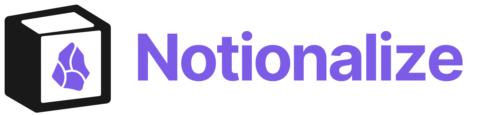
</p>

<h1 align="center">Notion's best ideas, inside Obsidian</h1>

<p align="center">
    <br>
    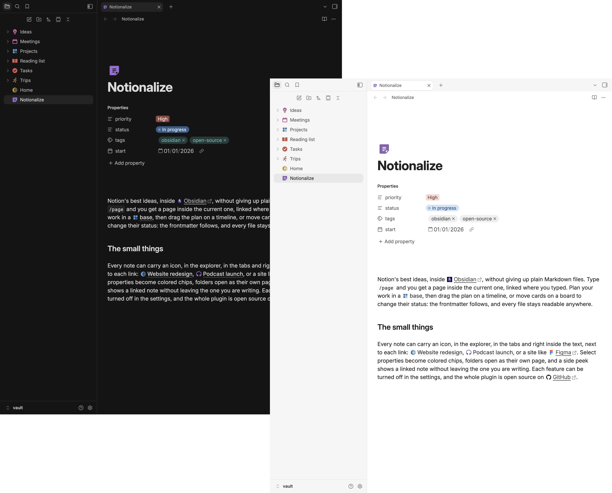
</p>

> [!IMPORTANT]
> Notionalize is a plugin for Obsidian, not an official product of Notion. This is a personal project by [Willy Brauner](https://willybrauner.com), inspired by Notion's ideas and the Obsidian community.

> [!NOTE]
> The features are largely developed with AI assistance: each of them has its own `AGENTS.md` file, its implementation notes written for coding agents. There is no warranty on the operation of all the features, they have only been tested during six months of daily work for my own use. The plugin is highly opinionated and developed for my own workflow, but every feature can be turned off in _Settings → Notionalize_.

## Main features

### Folder pages

**Type `/page`, get a page inside the current one.** `/page Launch plan` creates `Launch plan/Launch plan.md`, links it where you typed and opens it. `/base` creates a database filtered on its own folder, `/todo` a task list with its status property and a first task.

<p align="center">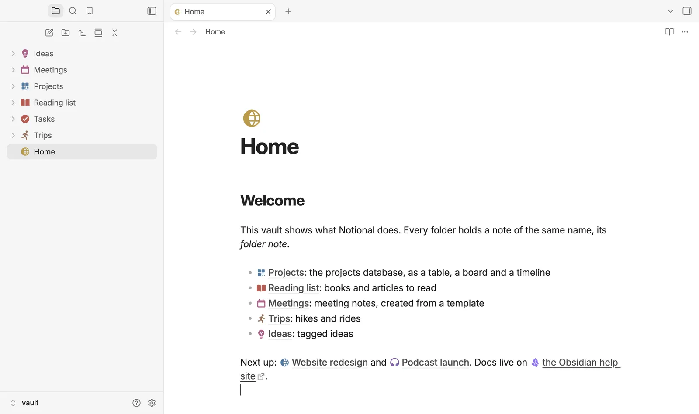</p>

[Folder pages docs →](docs/features/folder-page.md)

### Timeline view

**Plan in a base, then drag the plan.** Every dated note becomes a bar: move it, stretch it, reorder it. Draw a rectangle to select a whole cascade of tasks and shift them all in one drag. Zoom from days to the whole plan, jump back to today, create a note right on a date.

<p align="center">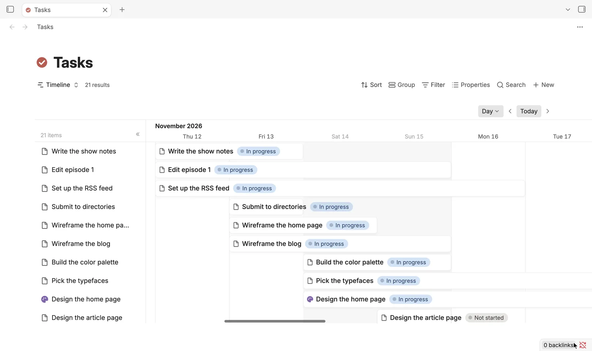</p>

[Timeline docs →](docs/features/timeline.md)

### Board view

**Drag cards, change values.** One column per status, tag or any select value. Move a card to change it, Alt-drag to copy it into another list, reorder cards and columns, hide the ones you don't need. Columns take the colors of your values.

<p align="center">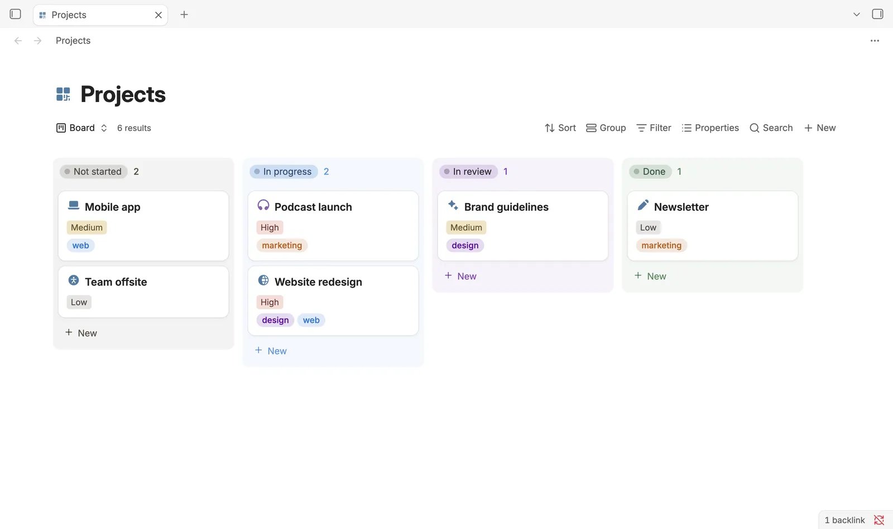</p>

[Board docs →](docs/features/board.md)

### Links in titles

**Type `@` in a title, mention another note.** "Design review of @Website redesign" becomes a title with a live link chip, with its icon. It is a real link: it shows in backlinks and the graph, and follows the note when it is renamed.

<p align="center">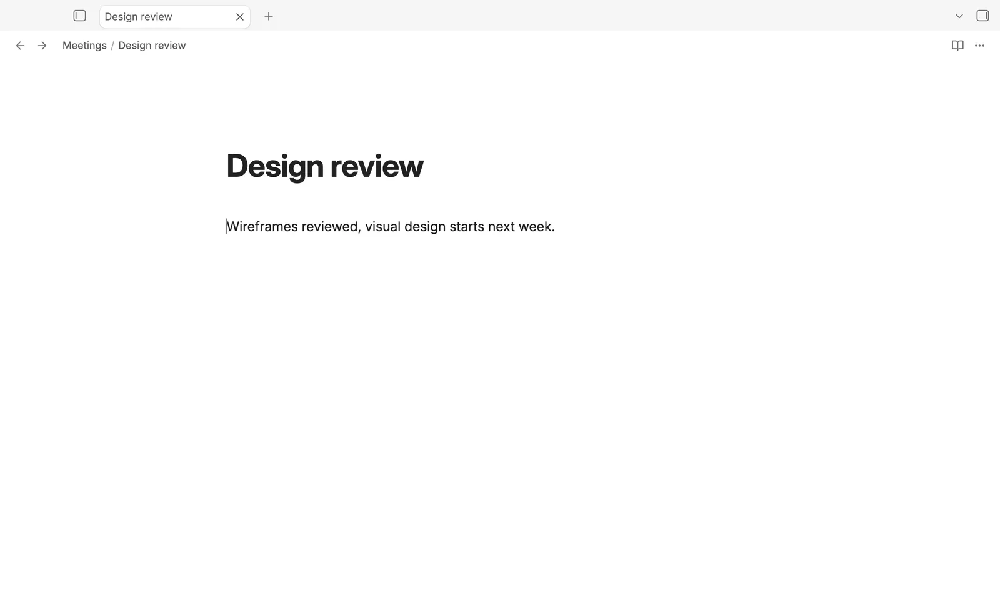</p>

[Mentions docs →](docs/features/title-mention.md)

### Side peek

**Open a note without leaving the base.** Click any row, card or bar: the note slides in on the right, fully editable. Escape closes it, Cmd+Enter opens it in full. Desktop.

<p align="center"></p>

[Side peek docs →](docs/features/side-peek.md)

### Icons, everywhere

**Give a note an icon once, see it everywhere.** In the file explorer, tabs, headers, bases, the quick switcher, and inside the text: links carry the icon of their note, external links the icon of their site. In light and dark.

<p align="center">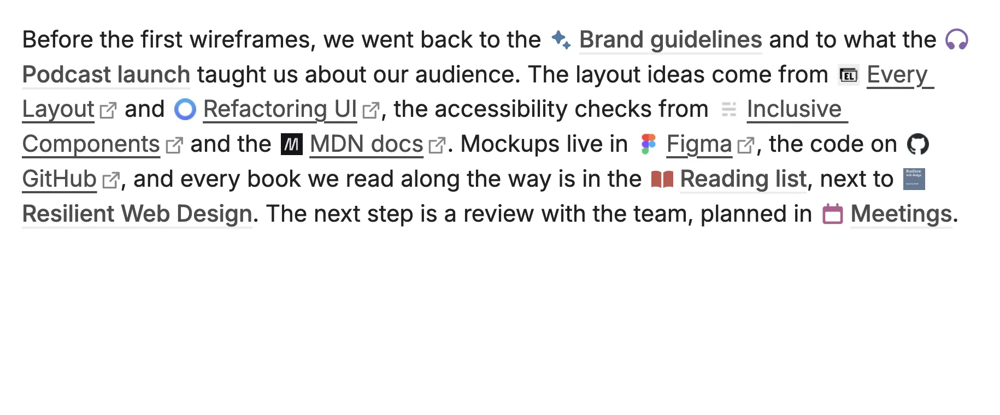</p>

[Icons docs →](docs/features/icons.md)

### Select chips

**Colored values, picked in a click.** Select properties become chips, in bases and in your notes, edited with a picker that also creates values. One color per value, shared by the chips, the board columns and your tags.

<p align="center">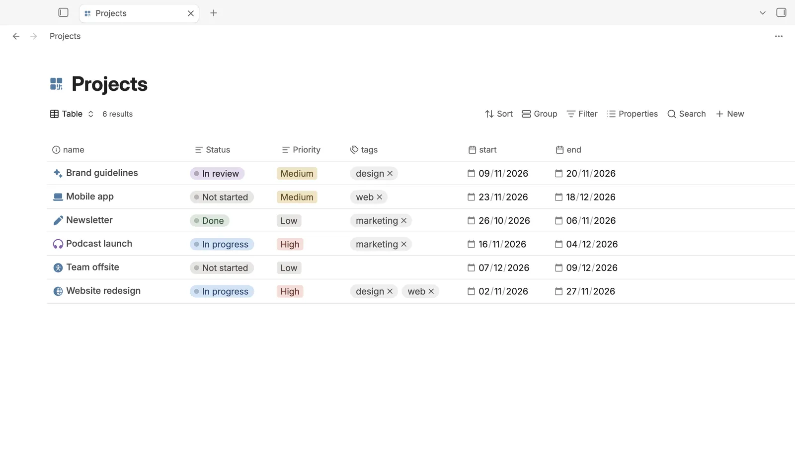</p>

[Select chips docs →](docs/features/select-property.md)

### Folder notes, the Notion way

A note and its folder become one page: `Projects/Projects.md`, or a base `Projects/Projects.base`.

<table>
<tr>
<td width="50%" valign="top">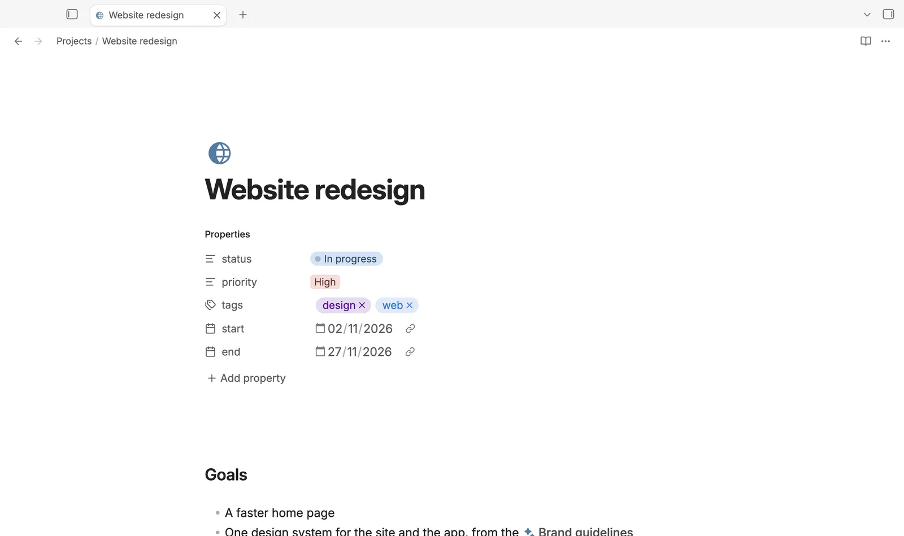<br><strong><a href="docs/features/breadcrumb-nav.md">Clickable breadcrumbs</a></strong><br>Click a folder in the path above a note, get its page.</td>
<td width="50%" valign="top">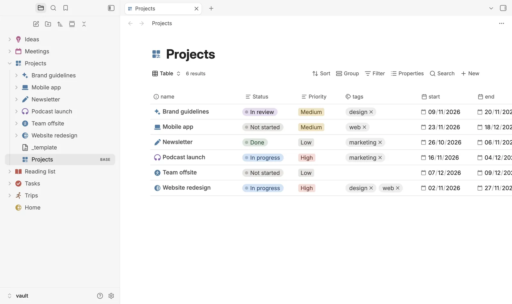<br><strong><a href="docs/features/database-header.md">Database header</a></strong><br>An editable title on every base. Rename it, its folder follows.</td>
</tr>
<tr>
<td width="50%" valign="top">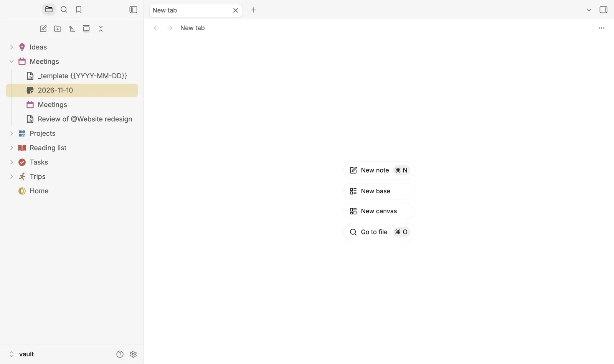<br><strong><a href="docs/features/note-template.md">Folder templates</a></strong><br>A new note starts from the <code>_template.md</code> of its folder, named after the day if you want.</td>
<td width="50%" valign="top">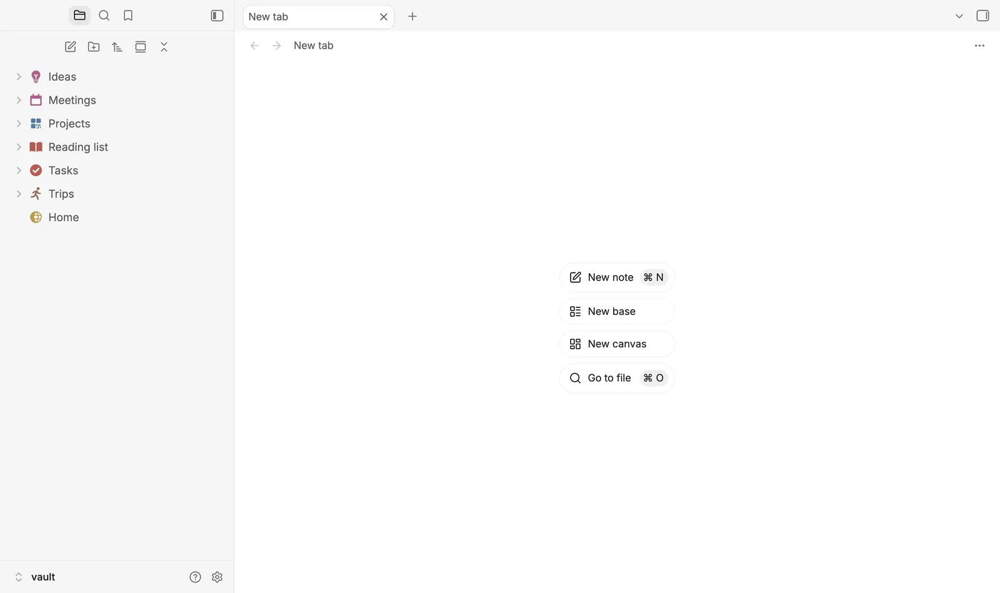<br><strong><a href="docs/features/folder-view.md">Open folder notes</a></strong><br>Click a folder, get its page.</td>
</tr>
</table>

Also: [folder-scoped bases](docs/features/auto-base-filter.md) (a base shows its own folder, new items land in it), [rename the folder with its note](docs/features/auto-rename-parent-folder.md), [inline rename in bases](docs/features/inline-note-rename.md).

### And the small things

- [Copy and paste cells](docs/features/table-clipboard.md): Cmd+C, Cmd+V on table cells, pasted into several at once.
- [Tag colors](docs/features/tag-colors.md): right-click a tag, pick a color.
- [Media drop](docs/features/media-drop.md): dropped files go to an `_assets` folder next to the note, images converted to WebP.
- [Clean search results](docs/features/reskin-search.md): file name, icon and folder in the quick switcher.
- [Format on save](docs/features/prettier.md), [Hide .base in links](docs/features/hide-base-extension.md), [Bases keep their own context](docs/features/base-own-context.md) (off by default).

### Visual tweaks

Six optional touches of Obsidian's look, off by default.

| Tweak                                                      |                                            |
| ---------------------------------------------------------- | ------------------------------------------ |
| [Grey accent](docs/features/tweak-accent.md)               | A grey accent instead of Obsidian's purple |
| [Darker dark mode](docs/features/tweak-dark-background.md) | A near black background in dark mode       |
| [Note typography](docs/features/tweak-typography.md)       | Larger headings, wider margins             |
| [Raised active tab](docs/features/tweak-tabs.md)           | The active tab looks raised                |
| [Plain properties](docs/features/tweak-properties.md)      | Properties without background              |
| [Bases layout](docs/features/tweak-bases-layout.md)        | Bases on the note margins, taller rows     |

## All features

Every feature is a toggle in _Settings → Notional_, with a link to its page. Turned off, it leaves nothing behind.

| Section       | Feature                                                                       | Default | Desktop only |
| ------------- | ----------------------------------------------------------------------------- | ------- | ------------ |
| Bases         | [Database header](docs/features/database-header.md)                           | On      |              |
| Bases         | [Hide .base in links](docs/features/hide-base-extension.md)                   | Off     |              |
| Bases         | [Folder-scoped bases](docs/features/auto-base-filter.md)                      | On      |              |
| Bases         | [Inline rename in bases](docs/features/inline-note-rename.md)                 | On      |              |
| Bases         | [Side peek](docs/features/side-peek.md)                                       | On      | Yes          |
| Bases         | [Timeline view](docs/features/timeline.md)                                    | On      |              |
| Bases         | [Board view](docs/features/board.md)                                          | On      |              |
| Bases         | [Copy and paste cells](docs/features/table-clipboard.md)                      | On      |              |
| Bases         | [Bases keep their own context](docs/features/base-own-context.md)             | Off     |              |
| Folder notes  | [Folder templates](docs/features/note-template.md)                            | On      |              |
| Folder notes  | [Folder pages](docs/features/folder-page.md)                                  | On      |              |
| Folder notes  | [Open folder notes](docs/features/folder-view.md)                             | On      |              |
| Folder notes  | [Rename the folder with its note](docs/features/auto-rename-parent-folder.md) | On      |              |
| Folder notes  | [Clickable breadcrumbs](docs/features/breadcrumb-nav.md)                      | On      |              |
| Properties    | [Select chips](docs/features/select-property.md)                              | On      |              |
| Properties    | [Tag colors](docs/features/tag-colors.md)                                     | On      |              |
| Icons         | [Icons](docs/features/icons.md)                                               | On      |              |
| Editor        | [Clean search results](docs/features/reskin-search.md)                        | On      |              |
| Editor        | [Media drop](docs/features/media-drop.md)                                     | On      |              |
| Editor        | [Format on save](docs/features/prettier.md)                                   | Off     |              |
| Editor        | [Mentions in titles](docs/features/title-mention.md)                          | On      |              |
| Visual tweaks | The six tweaks above                                                          | Off     |              |

---

## Installation

Notionalize needs Obsidian 1.10.2 or later (Bases), on desktop and mobile.

1. Download `main.js`, `manifest.json` and `styles.css` from the [latest release](https://github.com/willybrauner/notionalize/releases/latest).
2. Put them in `<your vault>/.obsidian/plugins/notionalize/`.
3. In _Settings → Community plugins_, turn on **Notionalize**.
4. In _Settings → Notional_, keep what you like.

## Privacy & network

- **No telemetry**: Notionalize sends nothing about you or your vault anywhere.
- **Website icons** (off by default, _Settings → Notionalize → Icons_): each domain shown, from external links and `url` properties, is sent to Google's favicon service (`https://www.google.com/s2/favicons?domain=<domain>`) to fetch its icon.
- Everything else stays in your vault: frontmatter, `.base` files, and the plugin's `data.json` (feature states, settings, icons, value colors). The side peek keeps its width in the vault's local storage.

## Development

```sh
pnpm install
pnpm dev        # build in watch mode
pnpm build      # production build into dist/
pnpm verify     # lint, unit tests, build, end-to-end tests
```

Set `NOTIONAL_PLUGIN_DIR` (environment, or `.env.local`) to a vault's `.obsidian/plugins/notionalize` folder to copy each build there.

- [Architecture](docs/architecture.md): features, the scoped plugin, the feature manager, `data.json` and its migrations, services, adding a feature.
- [Testing](docs/testing.md): unit, end-to-end (a real, isolated Obsidian) and manual checks.
- [AGENTS.md](AGENTS.md): conventions, and the `AGENTS.md` of each feature for its implementation.

## License

MIT, see [LICENSE](LICENSE). The bundled icons (Phosphor, MingCute, Fluent UI, Tabler, Heroicons, Simple Icons) and Prettier keep their own licenses: see [THIRD_PARTY_NOTICES.md](THIRD_PARTY_NOTICES.md).

## Credits

[Willy Brauner — willybrauner.com](https://willybrauner.com)
