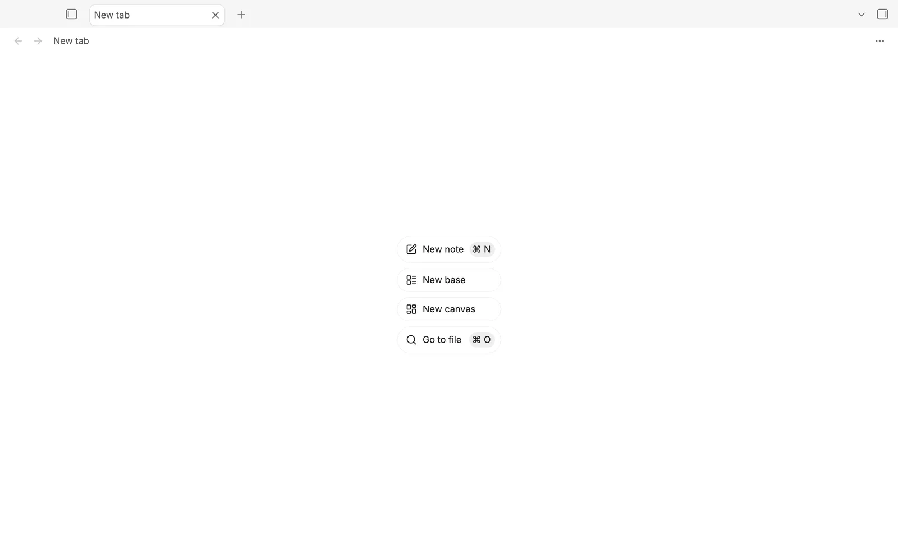

# Folder-scoped bases

Every base only shows the notes of its own folder and of its direct subfolder notes, and new items created from it land in that folder.

## How to use

- Create a base anywhere (file explorer, command, `/base`): it starts with a folder filter and a table view.
- Move or rename a base: its filter follows its new folder.
- Notes created from a base ("New" button, board column, timeline) are created in the base's folder, with its template (see [Folder templates](note-template.md)).
- Command **Set new item folder on all bases** adds that folder to the bases created before.

## Settings

*Settings → Notionalize → Bases*, on by default.

## Limits

- Only a new, empty base is filled. A base that arrives with content (sync, git, a copy) is left as it is, and so are the bases already in the vault when Obsidian starts.
- A base at the root of the vault gets no new item folder.

## What it writes

- The `filters:` block and `newItemFolder` of each base, when it is created, moved or renamed.

## Network

None.
