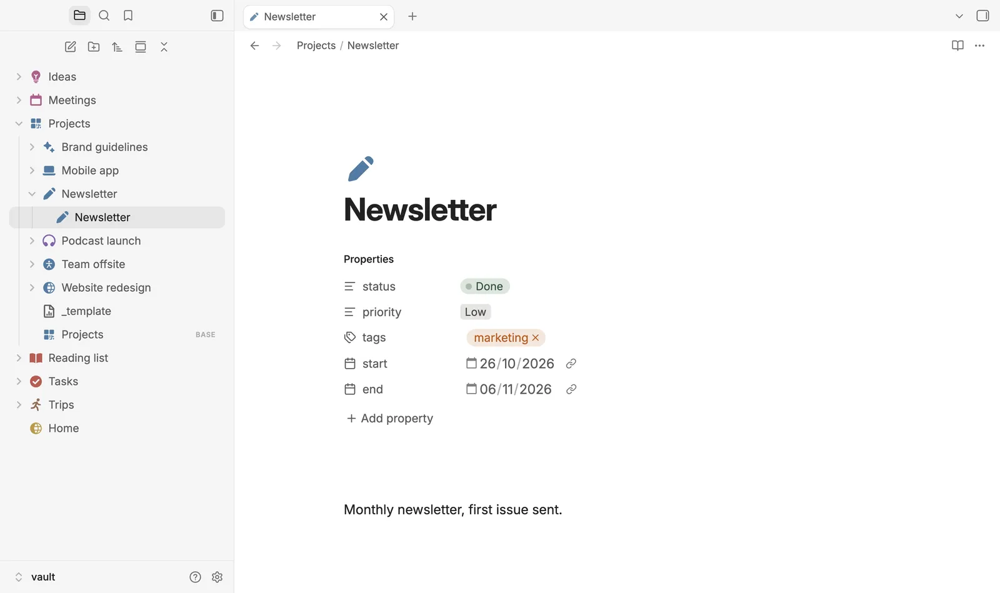

# Rename the folder with its note

Renaming a folder note renames its folder too, so a note and its folder keep the same name.

## How to use

- Rename `Projects/Newsletter/Newsletter.md` to "Monthly newsletter" (inline title, file explorer, any rename): the folder becomes `Projects/Monthly newsletter/`.
- Only a note named like its folder moves its folder: other notes are renamed alone.

## Settings

*Settings → Notionalize → Folder notes*, on by default.

## What it writes

The new name of the folder.

## Network

None.
