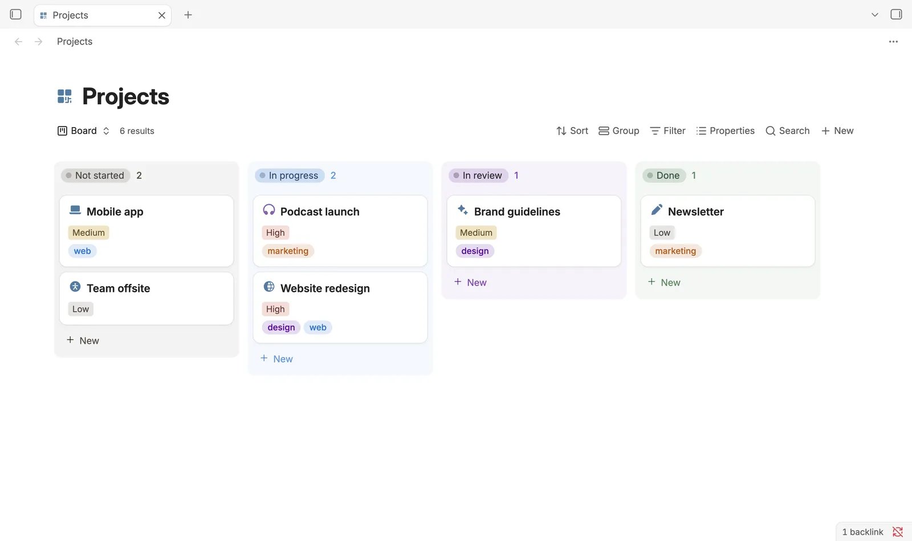

# Board view

A board view for bases: one column per value of a property, cards dragged from one column to another to change their value.

## How to use

- In a base, add a view and pick **Board**. It uses the base's **Group by** property, or the **Column property** of its options.
- Drag a card to another column to change its value, or within a column to reorder it (when the view has no sort). Hold Alt/Option while dropping to copy it instead, for a property with several values (tags, lists).
- A note with several values shows in each of their columns.
- Drag columns to reorder them. A column's menu changes its color or hides it; hidden columns are listed at the end of the board.
- "New" at the bottom of a column creates a note with that value.
- Draw a rectangle from an empty area to select cards, or Shift/Cmd-click them. Backspace deletes the selection, Escape clears it.
- Right-click a card: open in a new tab, open to the right, rename, delete.
- Select values on a card open the [select picker](select-property.md). Column colors are shared with the select chips.

## Settings

*Settings → Notionalize → Bases*, on by default.

View options: **Column property**, **Hidden columns**, **Column width**, **Image property** (a cover image on the cards), **Image fit**, **Image aspect ratio**.

## Limits

- Turned off, an open board shows Obsidian's "unknown view type" message; its settings stay in the `.base` file and the view comes back when the feature is on again.
- A drag in progress while the feature is turned off is not cancelled.

## What it writes

- The new value of a moved card, in the note's frontmatter.
- The view settings (column property, column and card order, hidden columns, width, image), in the `.base` file.
- Column colors, in the plugin's `data.json` (`selectColors`).
- Deleted notes go to the trash, as set in Obsidian's settings.

## Network

None.
