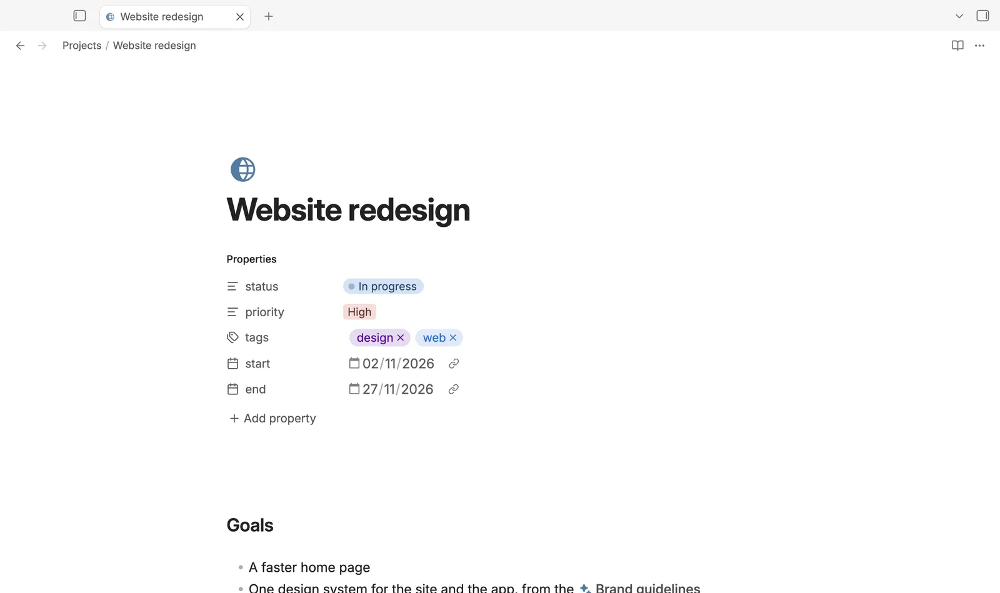

# Clickable breadcrumbs

Clicking a folder in the breadcrumb of a note header opens its folder note.

## How to use

- In `Projects / Website redesign`, click "Projects": `Projects/Projects.md` (or `.base`) opens.
- For a folder note (`X/X.md`), the last segment, the same as the title, is hidden.
- A folder without a folder note keeps Obsidian's behavior.

## Settings

*Settings → Notionalize → Folder notes*, on by default.

## What it writes

Nothing.

## Network

None.
