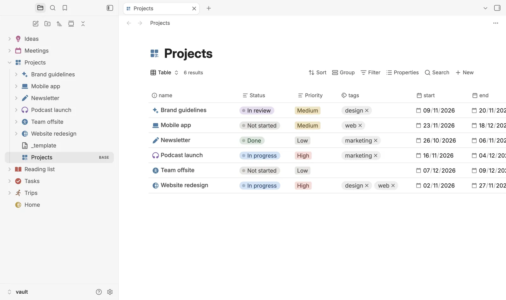

# Database header

Every open base shows its name as an editable title above its toolbar. Renaming it renames the base, and its folder when the folder has the same name.

## How to use

- Click the title, type the new name, press Enter (or click away). Escape cancels.
- `Projects/Projects.base` renamed to "Side projects" becomes `Side projects/Side projects.base`: the folder follows, and the folder filter of every base inside it is updated.
- With the [Icons](icons.md) feature on, the title gets the base's icon, and an "Add icon" button above it.

## Settings

*Settings → Notionalize → Bases*, on by default.

## What it writes

- The new names of the base and its folder.
- The folder filter and `newItemFolder` of the bases inside a renamed folder.

## Network

None.
