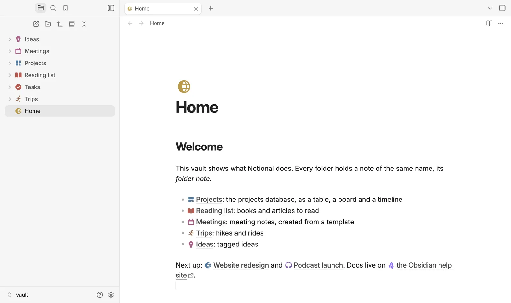

# Folder pages

Type `/page`, `/base` or `/todo` in a note to create a folder page, a folder base or a task list, linked where you typed it.

## How to use

- `/page Launch plan`, then Enter: creates `Launch plan/Launch plan.md` next to the current note, inserts a link to it and opens it.
- `/base Reading list`: creates `Reading list/Reading list.base`, a database filtered on its own folder.
- `/todo Sprint`: creates `Sprint/Sprint.base` with a **Status** select property (Not started, Selected for work, In progress, In review, Waiting, Done) and a first task, `First item.md`.
- The current note moves into its own folder first when it is not there yet (`Home.md` → `Home/Home.md`), so the folder page sits inside it.

## Settings

*Settings → Notionalize → Folder notes*, on by default.

## What it writes

- The new folder, the note or base, and its link in the current note.
- The move of the current note into its own folder.
- For `/todo`: the base with its status property, and `First item.md` with `status: "Not started"`.

## Network

None.
