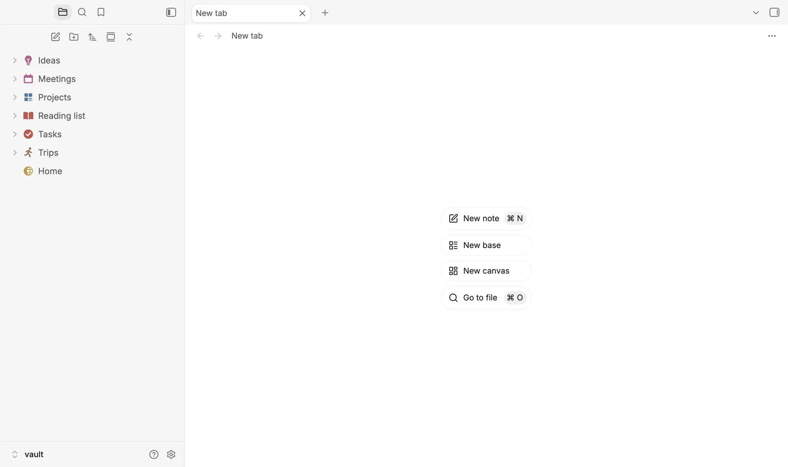

# Open folder notes

Clicking a folder in the file explorer opens its folder note: the note with the folder's name, `X/X.md` or `X/X.base`.

## How to use

- Click the name of a folder: its folder note opens in the current tab. `X.md` wins over `X.base`.
- A folder without a folder note folds and unfolds as usual. The chevron always folds the folder.

## Settings

*Settings → Notionalize → Folder notes*, on by default.

## What it writes

Nothing.

## Network

None.
