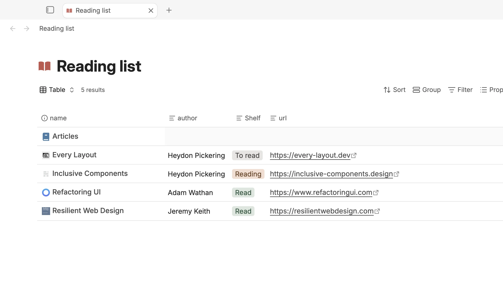

# Hide .base in links

Inside a base, links to other bases read "Articles" instead of "Articles.base".

## How to use

- Open a base listing other bases (a folder base showing its sub-databases): their links show no extension.

## Settings

*Settings → Notionalize → Bases*, off by default.

## What it writes

Nothing: only the link text shown in the base changes.

## Network

None.
