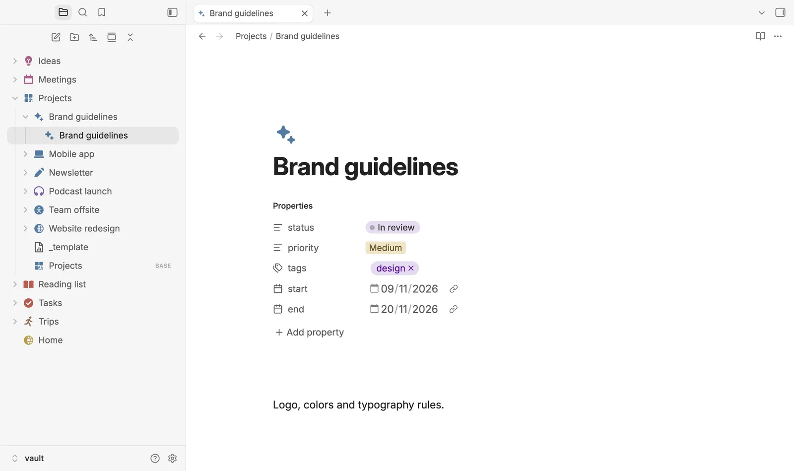
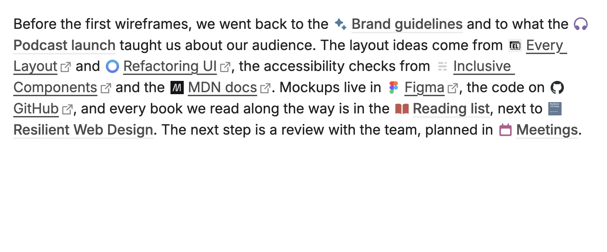

# Icons

Give notes and folders an icon and a color, shown in the file explorer, tabs, note headers, links, and in the bases.

## How to use

- Hover a note title or a base title and click **Add icon**, or click its icon: a picker opens with a search field, the recent icons, several hundred icons and an **Emoji** tab. Pick an icon, then its color (23 colors). **Remove** goes back to the default icon.
- A folder shows the icon of its folder note (`X/X.md` or `X/X.base`).
- Icons show in the file explorer, the tabs, note and base headers, internal links (reading view and editor), quick switcher and link suggestions, board cards, timeline bars and mentions.
- An icon follows its note when it is renamed or moved.

## Icon packs

Another plugin can add its own icons, or replace the bundled ones by name, with `app.plugins.plugins.notionalize.registerIconPack({ svgs: { name: '<svg …>' }, keywords: { name: ['search', 'words'] } })`. It returns the function removing the pack. Listen to the workspace event `notionalize:loaded` to register again when Notionalize reloads.

## Settings

*Settings → Notionalize → Icons*, on by default.

While it is on:

- **Website icons** (off): external links and notes with a `url` or `website` property (or another `https://` value) show the site's icon.

## What it writes

The icons and the recent icons, in the plugin's `data.json` (`icons`, `recentIcons`), by file path.

## Network

None, unless **Website icons** is on: then each domain shown is sent to Google's favicon service (`https://www.google.com/s2/favicons?domain=<domain>`) to fetch its icon.
