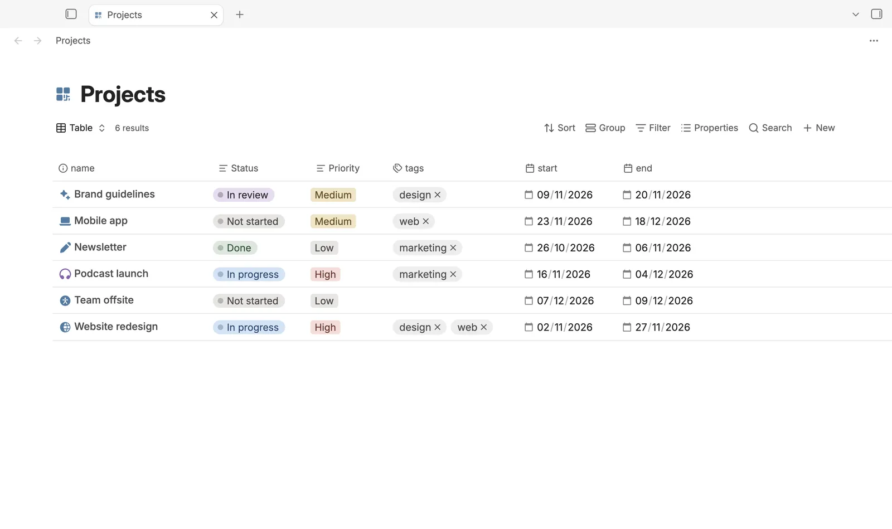

# Inline rename in bases

Double-click the name cell of a note in a base table or list to rename it in place.

## How to use

- Double-click the name cell, outside the link: an input opens over it with the note name.
- Enter or a click away saves, Escape cancels. A single click on the link still opens the note.
- The note stays in its folder. A note named like its folder renames its folder too (see [Rename the folder with its note](auto-rename-parent-folder.md)).

## Settings

*Settings → Notionalize → Bases*, on by default.

## What it writes

The new name of the note.

## Network

None.
