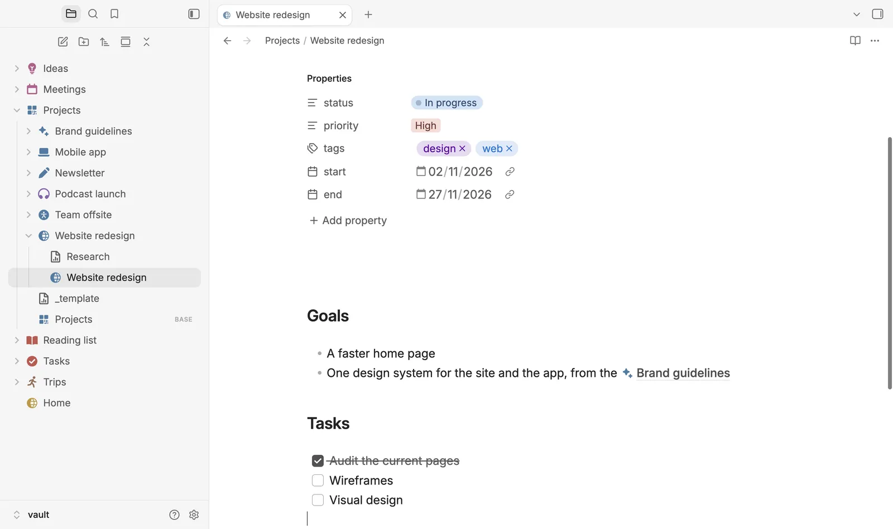

# Media drop

Files dropped or pasted in a note go to an `_assets` folder next to it, with PNG and JPG images converted to WebP.

## How to use

- Drop or paste an image, a video, a sound or a document in a note: it is saved to `<note folder>/_assets/` and a link to it is inserted at the cursor.
- The note moves into its own folder first when it is not there yet, so its media stay with it.
- PNG, JPG and HEIC images are converted to WebP, under a slugified name (`Moodboard.png` → `moodboard.webp`). GIF, SVG and WebP files are kept as they are.
- In a daily note, only images are taken over, and they go to the attachment folder of Obsidian's settings.
- Supported: `png jpg jpeg gif webp svg heic heif mp4 webm mov avi mp3 wav flac ogg pdf doc docx xls xlsx`. Other files are left to Obsidian.

## Settings

*Settings → Notionalize → Editor*, on by default.

While it is on:

- **Convert images to WebP** (on): PNG and JPG images are converted.
- **WebP quality** (80): from 1 to 100.
- **Convert HEIC images** (on, macOS only): HEIC and HEIF photos are converted too.

## Limits

- HEIC images are decoded by macOS (`sips`): on other platforms they are written as they are.
- When a conversion fails, the original file is written and a notice says so.

## What it writes

- The file in `_assets/`, and its link in the note.
- The move of the note into its own folder.
- The three settings, in the plugin's `data.json`.

## Network

None.
