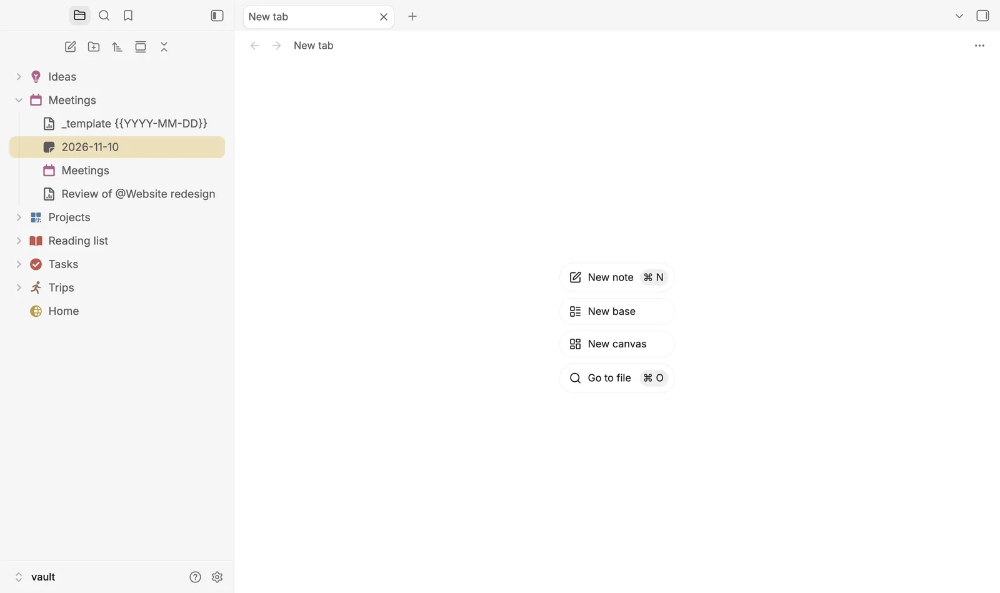

# Folder templates

A note created empty in a folder starts from the template of that folder: the first `_template*.md` file directly in it.

## How to use

- Put a `_template.md` in a folder. Every new empty note created in that folder (file explorer, command, base "New" button) gets its content.
- Tokens in the template: `{{date}}` (YYYY-MM-DD), `{{filename}}` (the note name), and any token made of `YYYY`, `MM` and `DD`, like `{{DD/MM/YYYY}}`. Unknown tokens are kept as written.
- Name the template `_template <pattern>.md` to name the note too, tokens in braces: `_template {{YYYY-MM-DD}}.md` names a new note `2026-11-13.md` (then `2026-11-13 1.md` if it exists).

## Settings

*Settings → Notionalize → Folder notes*, on by default.

## Limits

- Only templates directly in the note's folder count, not those of its parent folders.
- Only empty notes get the template: a note created with content, or the template itself, is left alone.

## What it writes

- The template content, written into the new note.
- The new name of the note, with a `_template <pattern>.md` template.

## Network

None.
