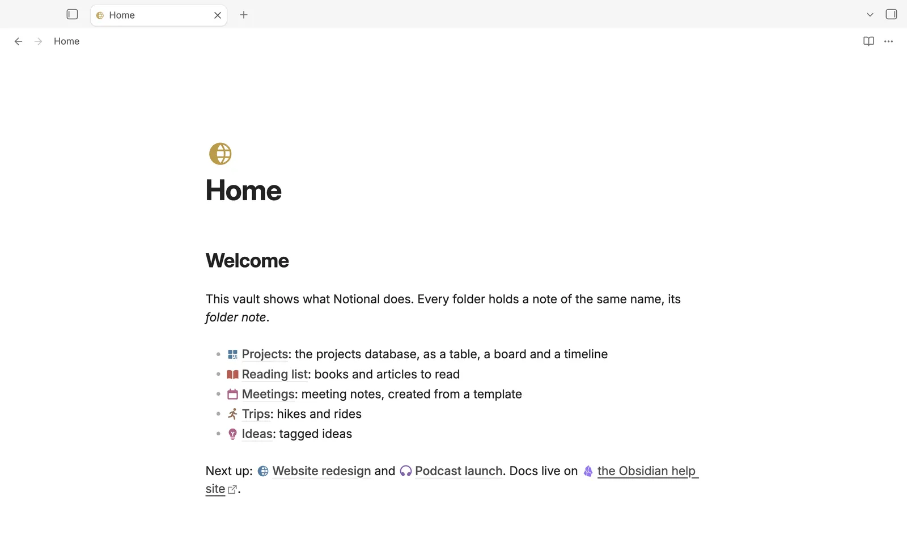

# Clean search results

The quick switcher and the link suggestions show the file name, its icon and its folder on a second line, instead of the full path.

## How to use

- Open the quick switcher (Cmd/Ctrl+O) or type `[[` in a note: each result shows its name, with its folder below it in a smaller, muted line.
- A base gets the base icon, any other file the file icon. With the [Icons](icons.md) feature on, a note shows its own icon in the link suggestions.

## Settings

*Settings → Notionalize → Editor*, on by default.

## Limits

- Restyles Obsidian's own suggestion lists (`.suggestion-item`), which can change with an Obsidian release.

## What it writes

Nothing: only the display of the suggestions changes.

## Network

None.
