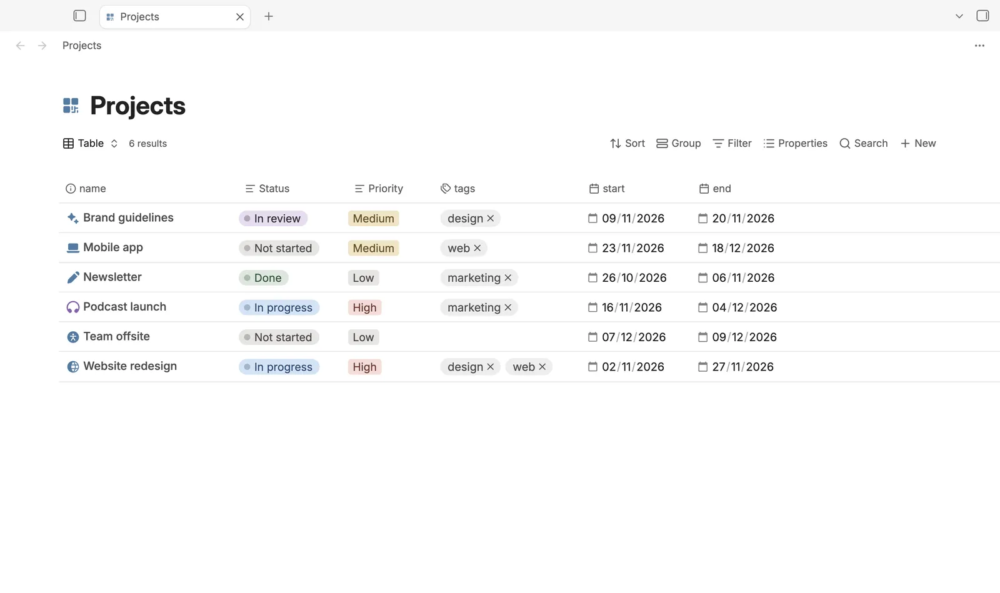

# Side peek

Notes opened from a base open in a panel on the right, over the base, like Notion's side peek.

## How to use

- Click a note in any base view (table, cards, list, board, timeline), or create one with "New": it opens in the panel. Only Escape or the close button at the top left of the panel closes it: the page behind stays usable while it is open, a click on it doesn't close the panel.
- The panel is a real tab: the note is edited as usual, and links clicked inside it open in the panel.
- **Open as full page** (or Cmd/Ctrl+Enter) opens the note in the tab behind.
- Drag the left border to resize it: the width is kept for every side peek.
- In a table, select the name cell with the arrow keys and press Enter to open the note in the panel.
- Cmd/Ctrl-click, Shift-click and middle click keep Obsidian's behavior (new tab).
- An open panel is still open after restarting Obsidian.

## Settings

*Settings → Notionalize → Bases*, on by default. Desktop app only: phones and tablets keep Obsidian's behavior.

## Limits

- Relies on Obsidian internals (tab groups, leaf ids, the "New" button menu), which can change with an Obsidian release.
- After a restart, the panel can show for a frame as a split before becoming the side peek again.

## What it writes

- The panel width and the open panel, in the vault's local storage (on this device only).

## Network

None.
