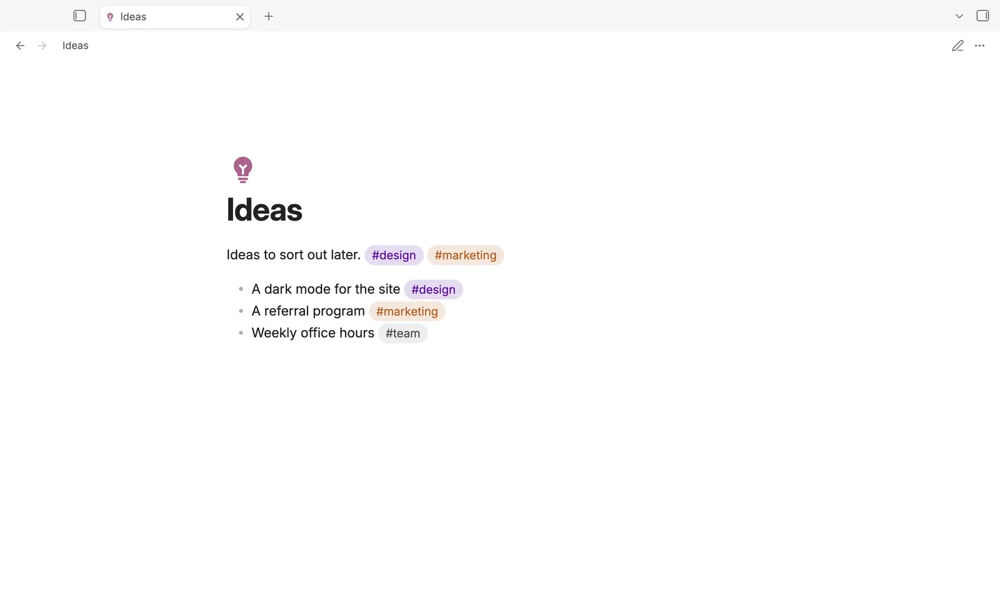

# Tag colors

Give tags a color, the same palette as the select chips.

## How to use

- Right-click a tag (long press on a phone) → **Change color**, then pick a color.
- Or run the command **Set tag color**, pick a tag, then its color.
- Tags take their color everywhere: in notes, in the editor, in properties, in popout windows.

## Settings

*Settings → Notionalize → Properties*, on by default.

## What it writes

The tag colors, in the plugin's `data.json` (`selectColors`, shared with the select chips).

## Network

None.
