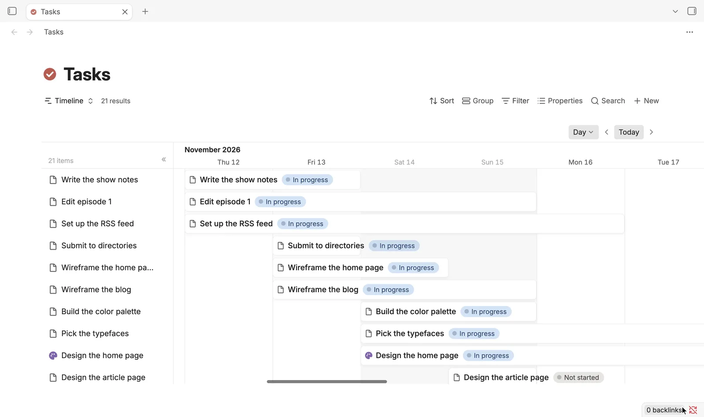

# Timeline view

A timeline view for bases: one bar per dated note, to move, resize and reorder, one at a time or a whole selection at once.

## How to use

- In a base, add a view and pick **Timeline**. It picks its **Start date** (a property named like Date, Start…) and **End date** (Due date, End, Deadline…), from the base's notes or else the vault's date properties, and saves them in the view options; change them there. A note with only the end date sits on that day.
- Drag a bar to move it, drag one of its ends to change a date. The bar snaps to days and shows the dates while it moves.
- Times: in the **Hour** zoom, notes with a time sit at their times and move by 15 minutes. Dragging a bar end there snaps to 15 minutes and gives a date-only note its times; a click on an empty row creates a one-hour slot. The other zooms show times on whole days. Resizing needs an **End date** property.
- Draw a rectangle from an empty area to select bars (Shift to add), or Shift-click a bar. Dragging one of them moves the whole selection. Backspace deletes the selection, Escape clears it.
- Drag a bar up or down to reorder notes sharing the same sort: the manual order is added to the view sort.
- Zoom: **Hour**, **Day**, **Week**, **Month** or **All**, and **Today** to come back to today. The timeline grows when you scroll to its ends.
- The list on the left can be resized by its edge, or collapsed. Click the last row at a date to create a note there.
- Right-click a bar or a title: open in a new tab, open to the right, rename, delete.
- Select values on a bar open the [select picker](select-property.md). Note icons show with the [Icons](icons.md) feature.

## Settings

*Settings → Notionalize → Bases*, on by default.

View options, in the base's view menu: **Start date**, **End date**, **Show list**.

## Limits

- Turned off, an open timeline shows Obsidian's "unknown view type" message; its settings stay in the `.base` file and the view comes back when the feature is on again.

## What it writes

- The start and end dates, in each note's frontmatter (`YYYY-MM-DD`, or `YYYY-MM-DDTHH:mm` for a property with a time).
- The type of the start and end properties, set to **Date & time** for the whole vault the first time a time is written (a **Date** property hides the time). Other types are left alone.
- The manual order, in a `timeline-order` property of the notes, only once you reorder by hand.
- The view settings (start and end properties, the guessed ones once on a new view, zoom, list width and state), in the `.base` file.
- Deleted notes go to the trash, as set in Obsidian's settings.

## Network

None.
