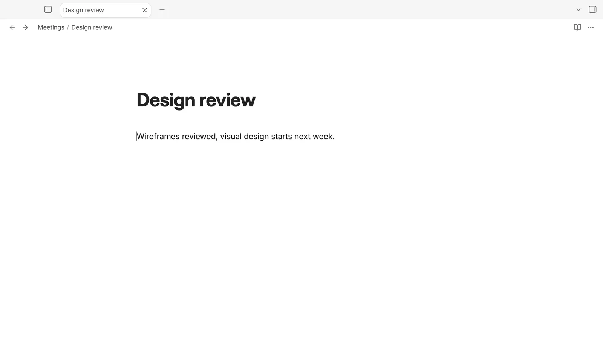

# Mentions in titles

Type `@` in the title of a note to mention another note: it shows as a link chip, with its icon.

## How to use

- In the title of a note, type `@` and a few letters, pick a note in the list: the title becomes "Design review of" followed by a chip of the mentioned note. Click the chip to open that note; click the rest of the title to edit it.
- Also works in the rename input of a base (double-click a name cell, or **Rename** on a board card or timeline bar).
- Renaming the mentioned note renames the notes that mention it.
- In a base table, a title made of the mention alone gets an **Open** button to open the note itself.

## Settings

*Settings → Notionalize → Editor*, on by default.

## Limits

- Mentions can't be created from the file explorer, which shows the plain file name, like tabs and breadcrumbs.
- The chip only shows while `@Name` is in the file name: renaming the note to something else drops the mention.

## What it writes

- The file name keeps the mention as text: `Design review of @Website redesign.md`.
- The link, in a `mentions` frontmatter property (`["[[Website redesign]]"]`), hidden in the properties. Being a real link, it shows in backlinks and the graph.

## Network

None.
