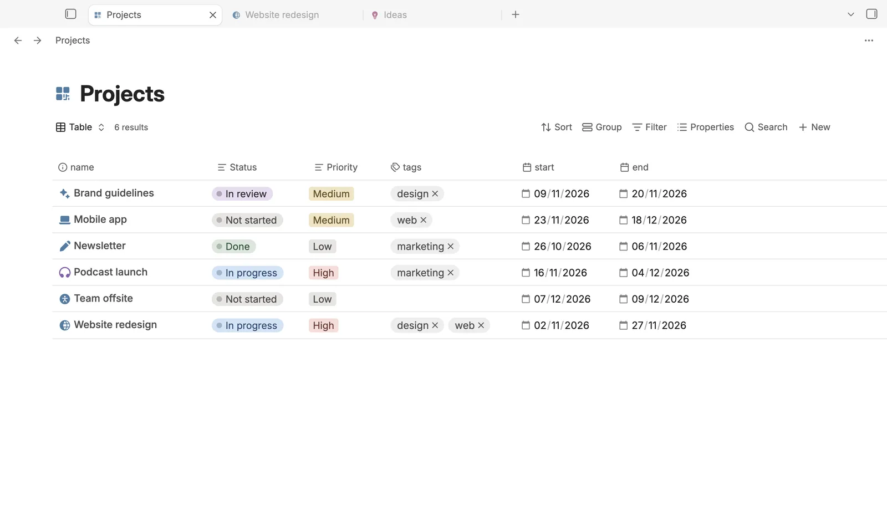

# Bases layout

Bases aligned on the note margins, with taller table rows, borderless headers, Notion-like lists (the title, then its properties on the same line, or on the line below with the view's *Indent properties* option) and denser cards.

*The image turns the tweak off, then on again.*

## How to use

Turn it on in *Settings → Notionalize → Visual tweaks* (off by default). It only changes styles: turning it off gives Obsidian's look back.

## Limits

- In a list, the properties that don't fit on their line are hidden.
- Styles Obsidian's own interface (its `.bases-*`, `.metadata-*`, tab and heading classes), which can change with an Obsidian release, as can a community theme.

## What it writes

Nothing.

## Network

None.
