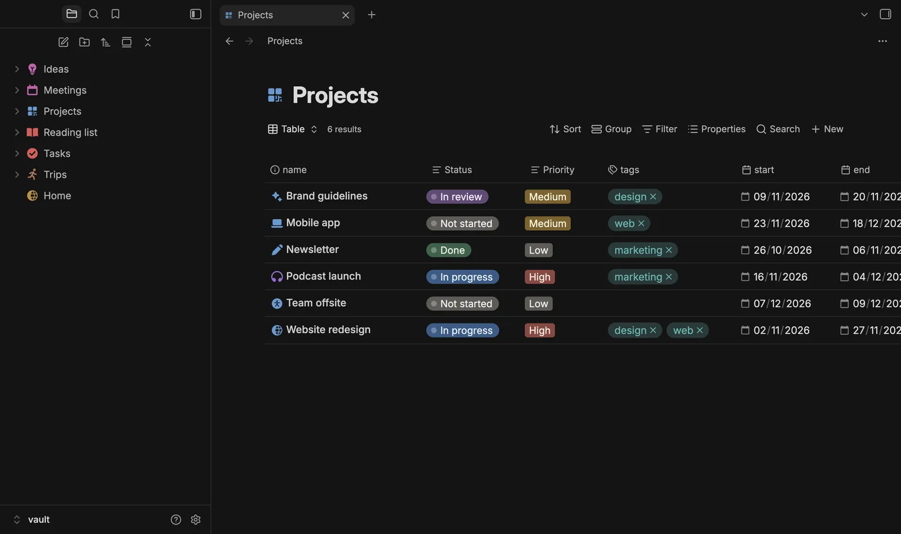

# Darker dark mode

A near black background for notes, sidebars and tables in dark mode.

*The image turns the tweak off, then on again.*

## How to use

Turn it on in *Settings → Notionalize → Visual tweaks* (off by default). It only changes styles: turning it off gives Obsidian's look back. Only applies to the dark theme.

## Limits

- Styles Obsidian's own interface (its `.bases-*`, `.metadata-*`, tab and heading classes), which can change with an Obsidian release, as can a community theme.

## What it writes

Nothing.

## Network

None.
